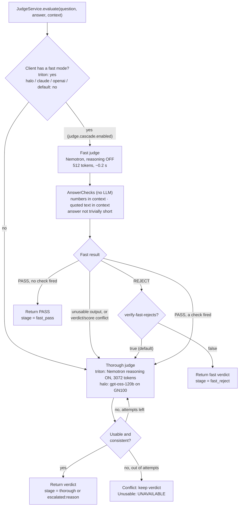
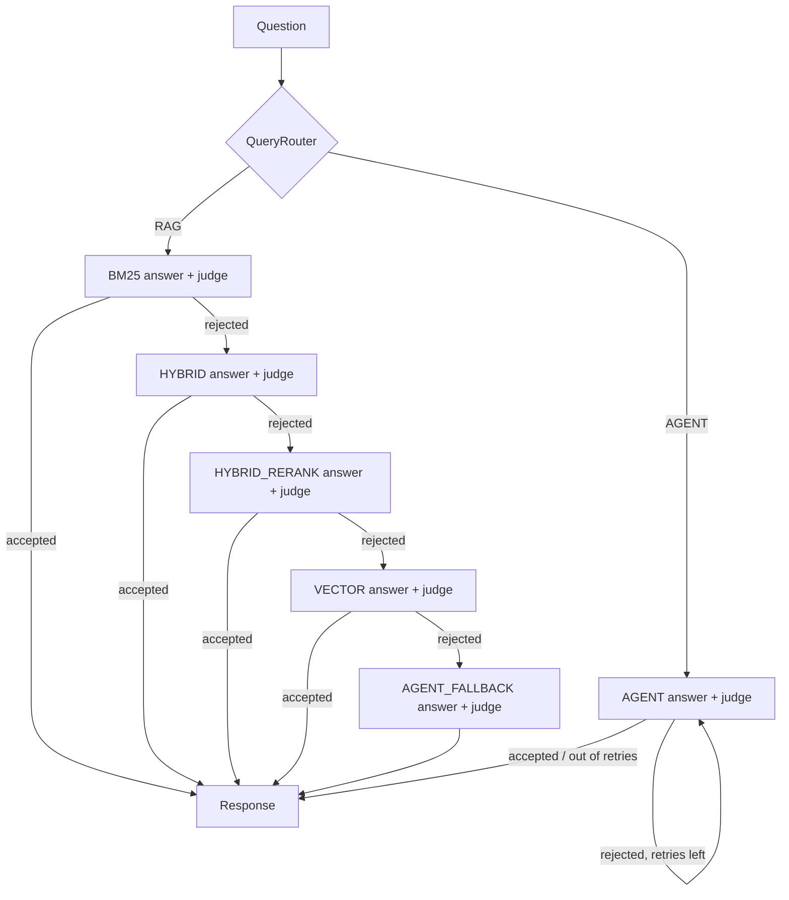
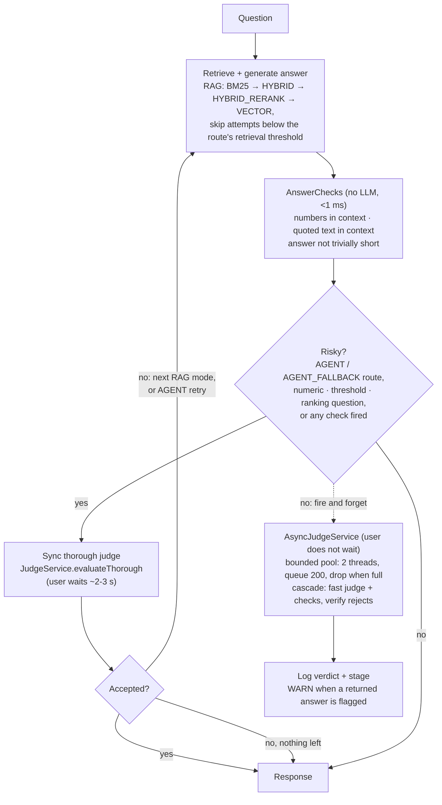

# Agentic RAG Platform (Hybrid Search + AI Workflows)

A production-grade agentic AI platform built with Spring Boot, pgvector, ParadeDB, Triton, and vLLM, supporting multi-agent orchestration, hybrid retrieval (BM25 + vector + RRF), semantic chunking, two-tier retrieval for fleet-scale search, batch ingestion, and full observability.

---

## Overview

This platform enables:

- **Multi-agent orchestration** — supervisor delegates to specialized agents (vehicle, article, research, communication) with inter-agent communication via shared tools
- **Single-agent workflows** — planner-executor pattern with 13 step types for backward compatibility
- **Hybrid RAG** — BM25 + vector + RRF fusion, with ParadeDB BM25 for single-query hybrid
- **Multi-domain ingestion** — PDF, vehicle specs, CMS articles with batch embedding
- **Semantic chunking** — by question category, not token count
- **Two-tier retrieval** — vehicle summary index (90K rows) + detail chunks for fleet-scale search
- **Three-layer answer validation** — citation validation, judge evaluation, judge reason validation
- **Pluggable LLM providers** — `LlmRouter` dispatches to vLLM, Triton-vLLM, OpenAI-compatible, Claude, or Ollama based on `llm.provider`
- **Pluggable judge providers** — `JudgeRouter` routes judge calls to Claude, OpenAI, or the default in-stack LLM independently of the answer LLM
- **Triton-backed embeddings + reranker** — `text_embedding` and `cross_reranker` served via Triton v2 inference API
- **Partitioned vector storage** — halfvec (float16) indexes with IVFFlat on vehicle partition
- **Evaluation pipelines** — 98.9% vehicle recall (28/29) and 100% article recall (19/19) across paired golden sets, with per-failure diagnosis and suggested fixes
- **Observability** — OpenTelemetry, LangSmith, session dashboard with full context visibility

---

## Architecture

### Multi-agent flow (POST /agent/multi)

```
User query
  -> SupervisorPlanner (numbered routing rules + few-shot examples)
  -> SupervisorAgent dispatches to specialized agents:
     -> ArticleSubAgent  (article search, vehicle-enriched content, judge validation)
     -> VehicleSubAgent  (specs, summaries, comparisons)
     -> ResearchSubAgent (PDF/document RAG with divergence detection)
     -> CommunicationSubAgent (email, SMS)
  -> Session state persisted with ArticleSnapshot, VehicleSnapshot
  -> Response with citations, judge score, metadata
```

### Single-agent flow (POST /agent)

```
User query
  -> PlannerService (structured JSON plan)
  -> AgentExecutorService (step-by-step dispatch)
  -> Tools (vehicle, research, email, SMS)
  -> State store (session tracking)
  -> Evaluation / re-plan
  -> Response
```

### Retrieval pipeline

```
User query
  -> Embed (TritonEmbeddingClient -> text_embedding, 768d)
  -> BM25 keyword search (ParadeDB Tantivy or PostgreSQL tsvector)
  -> Vector search (pgvector halfvec cosine)
  -> Weak-retrieval floor (fleet only: drop if best scores too low)
  -> RRF fusion (app-level or ParadeDB single-query)
  -> Numeric post-filter (fleet only: "over 500 hp", "under $40k")
  -> Re-ranking (TritonRerankerClient -> cross_reranker)
  -> Retrieval relevance judge (fleet only: strict LLM gate)
  -> LLM synthesis (LlmRouter -> active provider, default vLLM)
  -> Answer judge (JudgeRouter -> active provider, single verdict; cascade on Triton)
  -> Response with citations
```

The three "fleet only" steps are in `VehicleRagService.searchAllVehicles`
and the equivalent block in `ArticleRagService.searchAllArticles`. They are
the main contributors to the recall lift documented in the Evaluation
section below.

### Provider routing

Two independent routers sit in front of every LLM call. Both are `@Primary`
beans so the rest of the code just injects `LlmClient` and `JudgeClient`
and never knows which provider is active.

**`LlmRouter`** — dispatches answer + streaming calls based on `llm.provider`:

| `llm.provider` | Client | Endpoint shape |
|---|---|---|
| `vllm` | `VllmClient` | `POST /v1/chat/completions` (OpenAI-compatible), SSE streaming |
| `triton-vllm` | `TritonVllmClient` | `POST /v2/models/{model}/infer` (no streaming yet) |
| `openai` | `OpenAiClient` | `POST /v1/chat/completions` with bearer auth |
| `claude` | `ClaudeClient` | `POST /v1/messages` (Anthropic), non-streaming |
| `ollama` | `OllamaClient` | `POST /api/generate` with real token streaming |

Each concrete client is `@ConditionalOnProperty`, so only the active
provider's bean is created. `LlmRouter` uses `ObjectProvider.getIfAvailable()`
to pick up whichever one is in the context.

**`JudgeRouter`** — dispatches judge evaluations based on `judge.provider`:

| `judge.provider` | Client | Behavior |
|---|---|---|
| `claude` | `ClaudeJudgeClient` | Wraps `@Qualifier("claudeClient")` directly |
| `openai` | `OpenAiJudgeClient` | Wraps `@Qualifier("openAiClient")` directly |
| `default` / `vllm` / `ollama` | `DefaultJudgeClient` | Wraps the current `LlmRouter` — judge reuses whatever answer model is active |
| `halo` | `HaloJudgeClient` | gpt-oss-120b on the GN100 (llama.cpp, OpenAI-compatible); thorough only |
| `triton` | `TritonJudgeClient` | Nemotron-3-Nano-30B on Triton; fast (reasoning off) + thorough (reasoning on) modes, enables the cascade |

This split lets you run a cheap local model (vLLM / Ollama) for answer
generation while using Claude or OpenAI as a stronger independent judge,
or vice versa — without touching the rest of the pipeline.

`JudgeService` wraps the chosen client with: the verdict prompt, lenient JSON
extraction (strips markdown fences, finds first `{...}` object, also accepts the
old boolean shape), 1–10 to 0.0–1.0 score normalization, a verdict/score
consistency guard, retries, the fast/thorough cascade for clients with a fast
mode, and LangSmith span attributes (`judge.verdict`, `judge.stage`,
`judge.escalation_reason`). See [Answer judge](#answer-judge-verdict-contract-and-cascade).

### Two-tier fleet retrieval

```
Fleet query ("which car has best fuel economy?")
  -> Tier 1: vehicle_summaries (90K rows, HNSW on halfvec) -> top-10 candidates  (~5ms)
  -> Tier 2: chunks_vehicle WHERE doc_id IN (top-10) -> detail chunks           (<1ms)
  -> Total: ~6ms instead of 500ms-2s with single-tier at 9M chunks
```

### Answer judge: verdict contract and cascade

`JudgeService` returns one **verdict** per answer. The `grounded` / `correct` / `complete`
booleans are derived from it (kept for logs, LangSmith and existing callers).

| Verdict | Meaning | Policy decision |
|---|---|---|
| `PASS` | Every claim supported and correct; honest "not in context" also passes | accept if score ≥ 0.70 |
| `UNSUPPORTED` | States a fact/number the context does not, or attaches a number to the wrong quantity | reject + retry |
| `INCORRECT` | Uses context facts but derives something wrongly (total, comparison, conclusion) | reject + retry |
| `INCOMPLETE` | Correct but leaves part of the question unanswered | accept if score ≥ 0.75, else reject + retry |
| `UNAVAILABLE` | Judge timed out / unusable output | fall back to the route's retrieval-score threshold |

Why one verdict: the old prompt's example JSON (`true/true/true/0.7`) was copied verbatim by a
non-reasoning judge, and `grounded` was ambiguous (both judges split on "numbers from the context
attached to the wrong quantity"). With the verdict prompt both Nemotron and gpt-oss-120b scored
24/24 decisions with 0 verdict/score conflicts (`scripts/judge-compare/judge_compare.py`).

#### Judge cascade (implemented — `JudgeService.evaluate`, `judge.provider: triton`)

Used by the async audit. The orchestrator's synchronous path calls `JudgeService.evaluateThorough`
(thorough judge only).



Consistency guard: `PASS` with score < 0.5, or `UNSUPPORTED`/`INCORRECT` with score ≥ 0.8, is
treated as unreliable (fast stage escalates, thorough stage retries once).

#### Before: judge on every attempt (`orchestrator.judge.sync: all`, rollback switch)



Every attempt above 0.15 retrieval score was judged synchronously, so one hard question could cost up to
5 generations and 5 judge calls before the user saw anything. (`AsyncJudgeService` existed but was never
called, and `@EnableAsync` is off, so its `@Async` would have run on the request thread anyway.)

#### Request flow (implemented — `orchestrator.judge.sync: risky`, default)



#### Real-traffic evaluation (`scripts/judge-compare/judge_eval.py`, 29 vehicle golden-set questions)

Same answers judged by both providers (Nemotron-generated from `/vehicles/ask` excerpts):

| | gpt-oss-120b (`halo`, thorough only) | Nemotron cascade (`triton`) |
|---|---|---|
| Accept/reject agreement | 83% (24/29) | |
| Latency p50 / avg / p95 | 2.2 s / 2.4 s / 4.5 s | 0.2 s / 1.3 s / 4.5 s |
| Stages | 29 thorough | 12 fast_pass (170 ms) · 6 fast_reject · 11 escalated (3.1 s) |

- Every case where the cascade looked wrong came from the **fast** stage (too-strict rejects,
  invented non-numeric claims passed). Nemotron's **thorough** judge disagreed with gpt-oss once —
  on invented mpg figures that the NumbersCheck proves are absent from the context, which gpt-oss missed.
- Offline replay of the 29 cases: refining the checks (ignore list markers and "Entry N" citations,
  add a quoted-text check and a short-answer check) and verifying fast rejects brings the cascade to
  ~1 wrong of 29 — but at ~59% escalation, only ~20-25% faster than thorough-only. Hence the request
  flow above: thorough judge where the user waits, cascade for the async audit where it saves GPU time.
- On the 29 golden questions, the risk rules send 20/29 answers to the sync judge (12 by question type,
  8 because an answer check fired — 6 of those 8 were real problems). The golden set is deliberately
  heavy on numeric and ranking questions; general traffic should mostly take the async path.


---

## Multi-Agent Architecture

### Supervisor planner

The supervisor decomposes user requests into agent delegations using numbered routing rules:

1. Does the user mention "article", "review", "MotorTrend", "rated"? -> article agent
2. Does the user ask about specs, performance, engine, horsepower? -> vehicle agent
3. Does the user ask about documents or general knowledge? -> research agent
4. Does the user ask to email/text/send? -> communication agent (after content agent)

Seven few-shot examples in the prompt ensure reliable routing with llama3.1.

### Article sub-agent

Four execution paths routed by task + args:

| Path | Trigger | What it does |
|---|---|---|
| Single-article ask | `articleId` in args | Scoped RAG on one article |
| Cross-article search | Default | Search all articles, LLM synthesis, judge |
| Vehicle-scoped search | `vehicleQuery` in args | Find articles about a vehicle |
| Vehicle-enriched search | Task contains "top ranked" / "with specs" | Articles + shared tool spec fetch + merge + LLM + judge |

### Inter-agent communication

The article agent calls `FetchVehicleSpecsTool` directly (same Spring bean the vehicle agent uses). No circular dependency -- both agents depend on the tool, not on each other. This is the "shared tool" pattern.

Vehicle IDs are extracted from chunk text (`vehicleId:xxx` tokens embedded by `ArticleChunkBuilder`) with three-source priority:
1. Explicit args from supervisor
2. Chunk text regex: `vehicleId:([a-zA-Z0-9-]+)`
3. ArticleId naming convention fallback

### Three-layer answer validation

| Layer | What it catches | Action on failure |
|---|---|---|
| Citation validation | Hallucinated `[ID]` tags | Auto-correct to nearest valid ID, then retry with explicit valid ID list |
| Judge evaluation | Factual errors, incomplete answers | Retry with judge feedback if reason is validated |
| Judge reason validation | False negatives from judge | Skip retry if judge's "missing X" claims are contradicted by context |

Auto-correction maps hallucinated chunk indices to valid ones (e.g. `[bmw-m3-2025-competition:6]` -> `[bmw-m3-2025-competition:2]`) eliminating retry loops.

### Session observability

Every delegation's history entry includes:
- `_result`: contextChunks, retrievedArticles, vehicleSpecs, latency_ms, specs_resolved
- `_judge`: grounded, correct, complete, score, reason
- `ArticleSnapshot`: articleIds, extractedVehicleIds, resolvedVehicleIds, operation, judgeScore

---

## Domains

### 1. PDF documents

Semantic chunking via sliding window. Used for interview Q&A, technical guides, and general document RAG.

**Endpoint:** `POST /api/pdf/upload`

---

### 2. Vehicle specs

Rich structured ingestion -- one semantic chunk per question category. Supports simple flat records, full nested domain objects, and bulk ingestion.

**Simple ingest:** `POST /vehicles/ingest`
**Rich ingest:** `POST /vehicles/ingest/rich` (batch embed + summary population)
**Bulk ingest:** `POST /vehicles/ingest/bulk` (pages of 50, batch embed + batch upsert + summaries)

#### Chunk layout

| chunk_index | Type | Answers |
|---|---|---|
| :1 | identity | class, body style, fuel type, MSRP |
| :2 | performance | engine, hp, torque, 0-60, drivetrain |
| :3 | ownership_cost | 5-year cost, insurance, depreciation, resale |
| :4 | rankings | US News, Consumer Reports, KBB as narrative prose |
| :5 | safety | NHTSA, IIHS ratings, AEB, blind spot |
| :6 | features_trims | trim levels, added features, pricing |
| :7 | reviews | expert review scores and summaries |
| :10+ | maintenance | one chunk per service interval milestone |
| :20+ | recall | one chunk per open recall |

#### Two-tier retrieval

**Fleet search:** `POST /vehicles/ask/fleet`
Uses `vehicle_summaries` table (one embedding per vehicle) for Tier 1 candidate selection, then detail chunk retrieval scoped to candidates.

**Hybrid search:** `POST /vehicles/ask/hybrid`
ParadeDB BM25 + vector similarity in a single SQL query. Tunable `vectorWeight` parameter (0.0 = pure BM25, 1.0 = pure vector).

**Admin:** `GET /vehicles/admin/summaries`
Lists all vehicle summaries with embedding status and chunk counts.

---

### 3. CMS articles (MotorTrend)

Long-form article ingestion with many-to-many vehicle references. Articles feature vehicleId tokens in chunk anchors for clean vehicle ID extraction.

**Ingest:** `POST /articles/ingest`

#### Chunk types

| chunk_index | Type | Answers |
|---|---|---|
| :1 | identity + verdict | article metadata, overall verdict |
| :2 | ratings narrative | structured scores as prose |
| :3 | pros and cons | strengths and weaknesses |
| :4 | vehicle references | all vehicles featured (primary + competitors) |
| :10+ | article sections | one chunk per named section |
| :50+ | body text windows | overlapping windows from recursive splitter |

#### Vehicle anchor with IDs

Every chunk includes machine-parseable vehicle IDs:
```
MotorTrend comparison featuring 2025 BMW M3 Competition, 2025 Mercedes-AMG C63 S E Performance.
Vehicles: vehicleId:bmw-m3-2025-competition, vehicleId:mercedes-amg-c63-2025.
```

---

## Batch Ingestion

All ingestion paths use batch embedding and batch upsert:

| Path | Before (serial) | After (batch) |
|---|---|---|
| Rich vehicle (14 chunks) | 14 embed + 14 INSERT = 28 round-trips | 1 embed + 1 batch INSERT = 2 round-trips |
| Article (15 chunks) | 15 embed + 15 INSERT = 30 round-trips | 1 embed + 1 batch INSERT = 2 round-trips |
| Bulk (50 vehicles x 14 chunks) | 700 round-trips | ~22 embed + 1 batch INSERT per page |

Triton batch embedding is used for ingestion. Sub-batches are sent per HTTP call to the `text_embedding` model, and JDBC `BatchPreparedStatementSetter` handles batch INSERT/UPSERT.

---

## Partitioned Storage

The `document_chunks` table is partitioned by `doc_type`:

| Partition | Index type | Purpose |
|---|---|---|
| `chunks_vehicle` | IVFFlat on halfvec | Fast filtered search at 90K+ vehicles |
| `chunks_article` | HNSW on halfvec | High recall for smaller article corpus |
| `chunks_pdf` | HNSW on halfvec | General document search |

All indexes use `halfvec(768)` (float16) for 2x memory reduction. A trigger auto-populates `embedding_half` from `embedding` on every INSERT/UPDATE.

IVFFlat probe count is set per connection via HikariCP:
```properties
spring.datasource.hikari.connection-init-sql=SET ivfflat.probes = 10
```

---

## Evaluation

Two paired evaluation pipelines, one per document type, each with its own
golden set, breakdown by category and difficulty, and failure diagnosis.

**Run:**
- `GET /api/eval/vehicles/recall/report` — 29-entry vehicle golden set
- `GET /api/eval/articles/recall/report` — 19-entry article golden set

**Current results (top-5 retrieval):**

| | Recall | Precision | Pass |
|---|---|---|---|
| Vehicle | **98.9%** | 52.9% | 28 / 29 |
| Article | **100%** | 42.7% | 19 / 19 |

Both meet the 85% recall target. The single remaining failure
(`S4-005 "AWD vehicles"`) is `OUTRANKED` — the diagnostic system suggests
`topK=16` for `FLEET_FILTER` queries specifically, which is held back as
a future intervention rather than applied globally.

### How the recall got here

Five interventions, each attributable to a specific code change. Numbers
are the vehicle eval; the article path mirrors them where applicable.

1. **`docType` scoping** — `evaluate()` now calls
   `searchAllVehicles(query, topK, entry.docType)`, letting `PgVectorStore`
   scope the search to the right partition instead of scanning the full
   corpus.
2. **Weak-retrieval floor** — if `bestVector < 0.50 && bestKeyword < 0.2`,
   the search method returns an empty list. Stops false-positive chunks
   leaking through on nonsense queries (the `EDGE_CASE_LEAK` failure mode).
3. **Retrieval-time relevance judge** (`isRelevantAfterRetrieval`) — fused
   hits pass through a strict LLM judge with a
   `{"relevant": true|false}` contract before being returned. Fail-open on
   exception to protect recall. This is architecturally a second judge,
   distinct from the answer-time `JudgeRouter`.
4. **Cross-encoder reranker** — `TritonRerankerClient.score(...)` now
   chunks calls into batches of 32 (the model's `max_batch_size`) and
   reorders fused hits before the chunk-priority pass. Without this, the
   article side fell back to RRF order on every query.
5. **One chunk per article (article path only)** — after rerank, the
   article path keeps only the highest-scoring chunk per article before
   chunk-priority sort. Article queries naturally pull multiple chunks
   from the same article (identity + ratings + sections all match
   "Tesla Model 3 review"); without dedup, result lists redundantly
   surface the same article many times.

### Eval timeline

Three named runs, each with measurable deltas:

| Run | Vehicle recall | Article recall | What changed |
|---|---|---|---|
| Baseline | 86.7% | — | k=5, no relevance judge, no docType scoping |
| Mid | 95.4% (k=13) | 100% (k=13) | added: docType, floor, relevance judge, dedup, reranker batching |
| Current | **98.9% (k=5)** | **100% (k=5)** | back to k=5 — pipeline accurate enough that high topK is no longer needed |

The interesting result is the last one: with all the retrieval-quality
fixes in place, lowering `topK` from 13 to 5 *raised* recall on vehicles
from 95.4% to 98.9%. The smaller candidate pool (`max(topK*3, 12) = 15`
instead of 39) gives the relevance judge a cleaner context window and the
reranker fewer ties to break, so the right chunks land in top-5 more
reliably than they used to land in top-13.

### Vehicle eval — current breakdown

By category and difficulty for the vehicle pipeline at top-5:

| Category | Recall | Precision | Passed |
|---|---|---|---|
| PERFORMANCE | 100% | — | 3 / 3 |
| MAINTENANCE | 100% | — | 3 / 3 |
| SAFETY | 100% | — | 3 / 3 |
| FEATURES | 100% | — | 2 / 2 |
| RANKINGS | 100% | — | 4 / 4 |
| CROSS_CHUNK | 100% | — | 4 / 4 |
| OWNERSHIP_COST | 100% | — | 4 / 4 |
| FLEET_FILTER | 94.4% | — | 5 / 6 |

`OWNERSHIP_COST` recovered to 100% from 75% in the previous run — the
relevance judge no longer rejects the legitimate `S1-COST-002` query
("best resale value") at top-5 because the smaller fused pool surfaces
the BMW M3 ownership chunk (`:3`) cleanly instead of burying it among
performance and ranking chunks.

### Article eval — current breakdown

| Category | Recall | Precision | Notes |
|---|---|---|---|
| DIRECT_LOOKUP | 100% | mid | Identity-verdict chunk routinely top-1 |
| COMPARISON | 100% | mid | Comparison-test article surfaces well |
| RANKING | 100% | mid | Editor's-choice / best-of queries |
| VEHICLE_MENTION | 100% | high | Multi-article (e.g. "articles about Tesla Model 3") |
| SEMANTIC | 100% | mid | Conceptual queries — pros/cons + sections |
| CROSS_ARTICLE | 100% | low | Few queries answerable by combining articles |
| EDGE_CASE | 100% | — | Floor catches `xyzabc`; short-token (`M3`) works |

### Precision framing

<20% → 42.7%.** With k=13, article queries pulled
back 39 candidates spanning 6-7 unique articles, of which typically only
1 was correct, giving precision in the 14-18% range across multiple
runs. Reducing k to 5 (15 candidates) with the cross-encoder reranker
and per-article dedup in place lifted article-level precision to 42.7%
while holding 100% recall. This is the single largest precision
improvement in the work, and the lift is reproducible.

### Failure diagnosis taxonomy

Each failed entry produces a `FailureAnalysis` with a primary reason
and an actionable suggestion. This diagnostic loop is what made the
recall lift possible — every named intervention came from a specific
failure mode the system itself flagged.

| Reason | Meaning | Fix |
|---|---|---|
| MISSING_CHUNKS | Vehicle/article not ingested | Re-ingest |
| MISSING_CHUNK_TYPE | Simple ingest, needs rich | Re-ingest with rich payload |
| VOCABULARY_MISMATCH | Chunk text doesn't match query | Rewrite chunk prose |
| OUTRANKED | Chunk pushed below top-K | Increase topK or strengthen reranker |
| LOW_SCORE | Chunk scores below threshold | Add narrative context |
| EDGE_CASE_LEAK | Nonsense query returned results | Weak-retrieval floor / relevance judge |

---

## Observability

### Session dashboard
- All agent sessions persisted as immutable `AgentSessionState` snapshots
- `ArticleSnapshot` shows articleIds, extractedVehicleIds, resolvedVehicleIds, operation, judgeScore
- `VehicleSnapshot` shows vehicleId, summary, specChunkIds
- History entries include `_result` (context chunks, retrieval scores) and `_judge` (grounded, score, reason)

### Tracing
- **OpenTelemetry:** spans on retrieval, embedding, LLM, RRF fusion
- **LangSmith:** execution traces, prompt inspection, workflow monitoring

---

## Tech stack

| Component | Technology |
|---|---|
| Runtime | Java 21 / Spring Boot 3.5 |
| Vector store | PostgreSQL 16 + pgvector 0.8 (HNSW, IVFFlat, halfvec) |
| Full-text search | ParadeDB pg_search (Tantivy BM25) |
| Embeddings | Triton `text_embedding` (768d) via `TritonEmbeddingClient` |
| Reranker | Triton `cross_reranker` via `TritonRerankerClient` |
| LLM (default) | vLLM `meta-llama/Meta-Llama-3.1-8B-Instruct` via `VllmClient` |
| LLM (pluggable) | `LlmRouter` → vLLM · Triton-vLLM · OpenAI · Claude · Ollama |
| Judge (default) | `DefaultJudgeClient` reuses the active `LlmRouter` |
| Judge (pluggable) | `JudgeRouter` → Claude · OpenAI · default · halo (gpt-oss-120b) · triton (Nemotron cascade) |
| Keyword search | PostgreSQL tsvector + ParadeDB BM25 |
| Container | Docker (paradedb/paradedb:0.19.11-pg16) |
| Observability | OpenTelemetry + LangSmith |

---

## Key design decisions

**Chunking = partitioning.** Semantic chunking is a partitioning problem -- split by access pattern (question type), not data structure.

**Push filtering into retrieval, not LLM.** Every structural decision that can be made by the retriever should be. Embedding models cannot rank by numeric value -- `NumericFilter` handles that.

**UAC-first chunk text.** Chunk text matches user query vocabulary: `"Ranked 2nd of 18 sports sedans"` embeds better than `"rank:2, total:18"`.

**Two-tier retrieval.** At 90K vehicles, scan summaries (90K rows) first, then detail chunks within candidates. Reduces fleet search from 500ms to ~6ms.

**Auto-correct citations.** LLMs hallucinate chunk indices. Auto-correct `[vehicle:6]` to `[vehicle:2]` (same prefix, valid ID) instead of burning retries.

**One verdict, cheap checks first.** The judge returns a single verdict instead of booleans that can contradict each other and the score. A deterministic NumbersCheck (every number in the answer must be in the context) catches invented figures that even a 120B judge missed, and decides when the fast judge must escalate to the reasoning judge.

**Judge reason validation.** Don't blindly feed judge feedback into retry prompts. If the judge says "missing specs" but specs are in the context, the judge is wrong -- skip retry.

**Shared tool pattern.** Inter-agent communication via Spring DI -- both agents depend on the tool, not on each other. No circular dependencies.

**Partitioned indexes.** IVFFlat on vehicle partition (fast filtered search), HNSW on article/pdf (higher recall, smaller corpus). halfvec for 2x memory reduction.

**Answer and judge are separately pluggable.** `LlmRouter` and `JudgeRouter` are both `@Primary` and both read a single `*.provider` key. The answer model and judge model can be swapped independently — local vLLM answers judged by Claude, for example — without touching any call site. Each concrete client is `@ConditionalOnProperty`, so unused providers never instantiate.

---

## Experiments

### LlamaIndex comparison (`experiments/llamaindex/`)

### LlamaIndex comparison (`experiments/llamaindex/`)

Python-based LlamaIndex experiment mirroring the Java RAG pipeline stage-by-stage:
- Triton embeddings + vLLM answer generation
- Same Postgres DB (pgvector table `data_llamaindex_chunks`)
- Side-by-side retrieval comparison (vector, BM25, hybrid)
- BM25 in LlamaIndex is in-memory Python (`rank_bm25`), not pg-side FTS

### LangGraph / LangGraph multi-agent (`experiments/langgraph/`, `experiments/langgraph-multi/`)

Python-based graph and multi-agent experiments using Triton for embeddings and vLLM for planner / generation / judge, for comparison with the Java orchestration patterns.

---

## Running

### Prerequisites
- Java 21
- Docker Desktop
- Triton running with `text_embedding` and `cross_reranker`
- vLLM running with `meta-llama/Meta-Llama-3.1-8B-Instruct`

### Provider configuration

All provider selection is driven from `application.yml` (or the equivalent
environment variables). Defaults in the repo:

```yaml
llm:
  provider: vllm                  # vllm | triton-vllm | openai | claude | ollama
  vllm:
    base-url: http://localhost:8001
    model: meta-llama/Meta-Llama-3.1-8B-Instruct
  triton:
    base-url: http://localhost:8000
    model-name: llama-3.1-8b

judge:
  provider: ${JUDGE_PROVIDER:triton} # triton | halo | claude | openai | default | vllm | ollama
                                  # default/vllm/ollama all go through DefaultJudgeClient
                                  # and inherit whichever LlmRouter provider is active
  cascade:
    enabled: true                 # only for clients with a fast mode (triton)
    verify-fast-rejects: false
  thorough-attempts: 2
  triton:
    model-name: nemotron
    fast-max-tokens: 512          # reasoning off
    thorough-max-tokens: 3072     # reasoning on (1024 cut reasoning off on hard cases)

embedding:
  provider: triton                # triton | ollama
  triton:
    base-url: http://localhost:8000
    model-name: text_embedding

reranker:
  triton:
    base-url: http://localhost:8000
    model-name: cross_reranker

claude:
  api:
    key: ${ANTHROPIC_API_KEY:}
  model: claude-sonnet-4-6

openai:
  base-url: http://localhost:8001  # points at vLLM's OpenAI-compatible endpoint by default
  api:
    key: ${OPENAI_API_KEY:}
  model: meta-llama/Meta-Llama-3.1-8B-Instruct
```

Switching the answer LLM and the judge are independent — set
`llm.provider: vllm` and `judge.provider: claude` to answer locally and
judge with Claude, for example.

### Triton inference contracts

All three Triton-backed clients speak the same v2 inference API shape
(`POST /v2/models/{model}/infer`) with JSON payloads:

| Client | Input tensors | Output tensor | Datatype |
|---|---|---|---|
| `TritonEmbeddingClient` | `TEXT` shape `[batch, 1]` | `EMBEDDING` shape `[batch, dim]` | `BYTES` in, floats out |
| `TritonRerankerClient` | `QUERY` + `DOCUMENT` each shape `[N, 1]` | `SCORE` shape `[N, 1]` (or flat `[N]`) | `BYTES` in, floats out |
| `TritonVllmClient` | `text_input` shape `[1]` | `text_output` shape `[1]` | `BYTES` in, `BYTES` out |

`TritonEmbeddingAdapter` (conditional on `embedding.provider=triton`)
implements the `EmbeddingClient` interface, so ingestion and retrieval
code stays unchanged when swapping between Triton and Ollama embeddings.

### Start infrastructure
```bash
docker compose up -d    # Postgres + Triton + vLLM
```

### Run migration
```bash
# Apply partitioning + two-tier + ParadeDB
docker exec -i ai-rag-postgres psql -U postgres -d ai_rag_assistant < V2__partition_two_tier_paradedb.sql
```

### Start application
```bash
./mvnw spring-boot:run
```

### Seed data
Run `.http` files in IntelliJ in order:
1. `src/test/java/resources/ingestion/vehicle/seed_vehicles.http`
2. `src/test/java/resources/ingestion/vehicle/rich_vehicle_ingest.http`
3. `src/test/java/resources/performance/twoTier/two-tier-retrieval-test.http`
4. `src/test/java/resources/agent/multi-agent.http`
5. any scenario-specific files under `src/test/java/resources/ask/`, `stream/`, or `ingestion/article/`

### Run tests
```bash
./mvnw test
```
