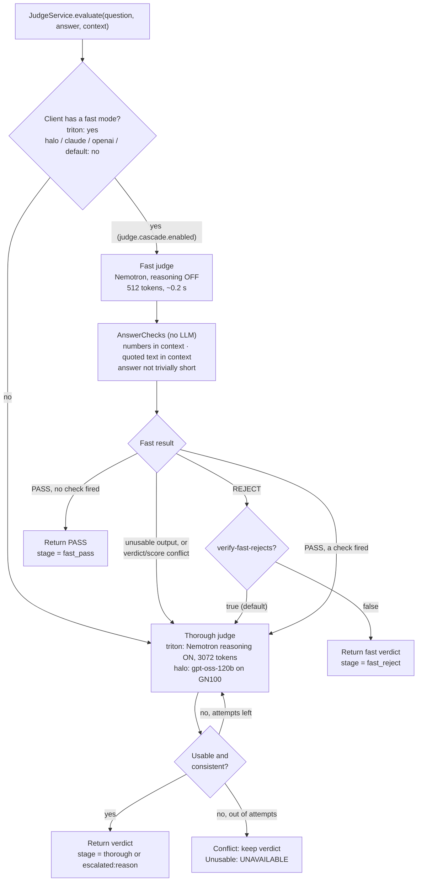

# Judge comparison and evaluation scripts

Tools used to design and validate the answer judge (verdict contract + fast/thorough cascade).
Architecture, all flow diagrams and results: [main README → Answer judge](../../README.md#answer-judge-verdict-contract-and-cascade).

Run everything from `C:\dev\ai-rag-assistant`. Standard library Python 3.9+, no installs.

## Judge cascade (implemented in `JudgeService.evaluate`, `judge.provider: triton`)

Used by the async audit; the orchestrator's sync path for risky answers uses the thorough judge only
(see the request-flow diagram in the main README).



## `judge_compare.py` — synthetic head-to-head (8 cases with known verdicts)

Calls the models directly (Triton `nemotron` on :8000, gpt-oss-120b on the GN100), no app needed.
Each case tests one judging skill: supported, paraphrase, invented claim, swapped numbers,
right/wrong arithmetic, wrong context, honest "not in context".

```powershell
python scripts\judge-compare\judge_compare.py --prompt verdict                                   # fast Nemotron vs gpt-oss
python scripts\judge-compare\judge_compare.py --prompt verdict --nemotron-think --max-tokens 3072 --runs 3
python scripts\judge-compare\judge_compare.py --prompt current                                   # old boolean prompt (baseline)
python scripts\judge-compare\judge_compare.py --only swapped_numbers -v                          # one case, raw output
```

Reports decision accuracy (what the app's policy would do), category accuracy, verdict/score
conflicts, valid JSON, latency, and how the NumbersCheck trigger does on each case.

| Run | Nemotron-30B | gpt-oss-120b |
|---|---|---|
| old prompt, Nemotron thinking off | 8/13 fields, every score 0.7 (copied the template) | 12/13 |
| verdict prompt, thinking off | 6/8 decisions, 0 conflicts | 8/8 |
| verdict prompt, thinking on, 3072 tokens, 3 runs | **24/24**, 0 conflicts, 1.2 s | **24/24**, 0 conflicts, 1.6 s |

## `judge_eval.py` — real golden-set questions through the app

Needs the app on :8080 (with `judge.debug.enabled=true`) and `triton-rag` up.

```powershell
python scripts\judge-compare\judge_eval.py generate                      # 29 vehicle questions -> /vehicles/ask -> Nemotron answer
python scripts\judge-compare\judge_eval.py judge --label triton          # app started with JUDGE_PROVIDER=triton (cascade)
python scripts\judge-compare\judge_eval.py judge --label triton-thorough --mode thorough   # the orchestrator's sync-path judge
python scripts\judge-compare\judge_eval.py judge --label halo            # app restarted with JUDGE_PROVIDER=halo
python scripts\judge-compare\judge_eval.py compare --a halo --b triton
```

`generate` saves the answers once (`eval-out/cases.json`), so every judge grades identical answers.
Check the run's `provider=` line: a `halo` run must show only `thorough` stages.
Context comes from `/vehicles/ask` 200-character excerpts, shorter than the app's real RAG context.

Results (2026-11-01): halo vs triton accept/reject agreement 83% (24/29); triton p50 0.2 s vs
halo 2.2 s. Every case where the cascade looked wrong came from the fast stage; the thorough
Nemotron judge disagreed with gpt-oss once, on invented mpg figures the NumbersCheck proves absent
(gpt-oss missed them).

`eval-out/` holds generated output; consider adding `scripts/judge-compare/eval-out/` to `.gitignore`.
